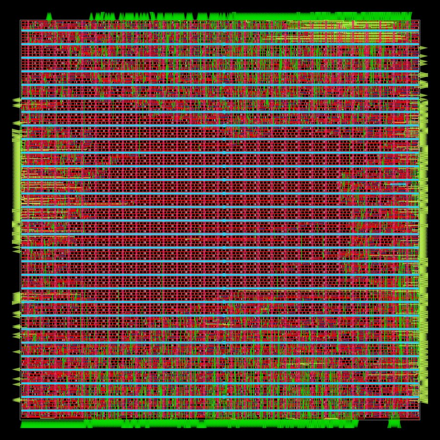
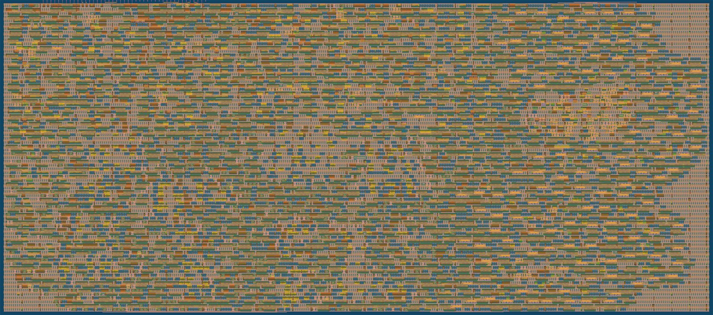

# Tea for two-by-two: Taping out tiny tiles


Welcome back! This is the second post in a series on a coarse-grained reconfigurable architecture (CGRA) I designed as part of a research project as an undergrad. This is a follow-up from my [last post](blog-mocarabe-fpga.html) which explains the architecture, the compiler, and my current project goals. Onto square two!

When I revived this project a few months ago, here were my goals
1. Dust off the cobwebs so that I can be proud of the project again
2. Turn it into a platform for experimenting with computer architecture and semiconductor engineering
3. Make a real Mocarabe chip with the TinyTapeout program

This post highlights my efforts towards item 3.   
I was working on a small team [taping out an FPGA product](https://www.zeroasic.com/blog/platypus-z1015-launch), and I knew that when it was over I wanted to turn the crank on a chip again, but this time on something I could fully own myself. Luckily, open-source EDA tools and the TinyTapeout program exist now, and I can get my own chip made for a few hundred bucks!


## I'm a little tapeout

I gathered I needed the following before I could submit to Tiny Tapeout:
- To get a generated Mocarabe architecture througn an ASIC synthesis flow
- To identify a realistic architecture given significant area and pin-count constraints
- To enhance the architecture with a pin-efficient programmable bitstream mode, an upgrade from its current static bitstream mode
- To verify the chip enough to justify the 600 American dubloons I had to pony up

Before we start, I need to actually choose a process node. The upcoming tapeouts when I was ready to start the project had Skywater 130 and GF180 on display. A man with less self-control than me might say "Skywater?  You mean... rain?" and "GF180? Sounds like my dating life", but I won't stoop so low. It seems like SKY130 is a better choice, since it's the original Tiny Tapeout target. Also, smaller is always better and 130nm < 180nm. Plus, I worked with a GF process in the past, so I need to maximize with resume keyword surface area.

TinyTapeout charges per "tile", with a tile coming in at around 18,000 µm² per Tiny Tapeout tile. The recommended density is around 60%. Finally, every TinyTapeout project on SKY130, no matter how many tiles it buys, has a hard constraints of 26 pins.
I'm pretty lucky because I have a highly parametrizable architecture; it's a two-dimensional array with highly configurable parameters. It's statically scheduled, so I can deterministically know how if a design will map to a given configuration. I have the following knobs to play with, so long as I can identify ~5 benchmark designs that can map onto the resulting architecture:

- configurable spatial grid and operator composition (MxN): the smallest realistic size is 2x2 processing elements (one mult, one input, one output, and one adder)
- the resource-use context width: the spatial dimension of the grid (MAX_T)
- data bitwidth (W): no need to preserve the 32-bit default
- the interconnect channel count (C): the minimum that will let the benchmark designs route

## Short and stout
### Synthesizing a small layout

First, I have to actually get the design running through an ASIC synthesis tool. The first step is linting the design.

I ran it through [slang](https://github.com/MikePopoloski/slang)'s linter and through the yosys-slang (now sv-elab) synthesis plugin. The linter told me I had to fix my `timescale` directives to be consistent throughtout every file (easy!).
Synthesis told me to fix this (it expressed itself by segfaulting):
```
 initial begin
      assign data = INIT;
      while (CLK === 1'b1 || CLK === 1'bX) #10;
      deassign data;
  end
```

which is a simulation-only trick: it pins data to `INIT` until the clock first goes low, then lets go. I swapped it for a plain reg [63:0] data = INIT;, which every tool I threw it at was happy with. This module was, for some reason, based on a simulation model of a Xilinx shift register primitive I stumbled on when I first wrote the RTL. Don't ask me why I didn't just write my own (I don't remember!).

So it synthesizes now. Let's run it through a sky130 flow! For this, I'll use [SiliconCompiler](https://github.com/siliconcompiler/siliconcompiler)'s stock `skywater130_demo` target on the same plain-jane test design my lint test uses: the `int_adder_chain` benchmark at II = 1 with 20 channels and the default 32-bit datapath:



That's not bad! It routed fine, but it will definitely take a few tiles. I haven't even added the programmable bitstream network yet, which will add some area.

Let's look at the worst case: where does the area go in the multiplier PE?

. Flip-flops are 72% of it; the multiplier is only about 4%.")

In this configuration (a 2x2 array with MAX_T = 6, W = 8, C = 2 and 16-deep operand FIFOs), the actual multiplier is a tiny amount of area. The overhead of the massive FIFOs that allow for such asynchronous data arrival times (e.g. if the dataflow graph is unbalanced ), the interconnect switches, and the configuration storage dominate. This is a high-overhead architecture. But I'm not changing it, because this is for fun!

To pin down an architecture, I had to add a fixed device JSON format, so that every benchmark compiles onto the *same* array. Until now the compiler sized the grid to each dataflow graph, which is fine for an FPGA overlay you can re-synthesize, but a chip only gets made once. A device file is an ASCII grid of PE types plus a channel count. The placer is only allowed to permute nodes onto matching PE types, and the compiler rejects a benchmark up front if it can't fit at the requested II.

Here's my proposed fixed architecture:

```json
{
  "name": "tt_2x2_1mul",
  "grid": [
    "+   * ",
    "IO  IO"
  ],
  "channels": 2,
  "ii_max": 6
}
```

## Here is my handle, here is my pinout
### Here's the pinout
Now you may want me to get to the programmable bistream. Unfortunately, that's not how the nursery rhyme goes, so I'm going to talk about pinout first.

As mentioned earlier, I have access to 26 pins (`clk`, `rst_n`, 8 `input`s, 8 `output`s, 8 `inout`s, no In-N-Outs). I'll have to share this between the bitstream-programming mode (which we will talk about soon, I promise!) and the regular run mode.

For the run mode, I have access to at most one byte of input and one byte of output per cycle. You might think I could steal 4 bits from the inouts for each and make this a 12-bit architecture, but I'm not insane and I need to add an a `output_valid` output pin in the inout range since the first few dozen cycles (until all inputs have been processed) can have invalid outputs. Since I've gone with a context length of 6, this is the upper bound on the designs I can map: they can have at the very most 6 inputs and 6 outputs.

Here's the pinout for the regular execution mode:

| Pin          | Run mode     |
|--------------|--------------|
| ui_in[7:0]   | input byte   |
| uo_out[7:0]  | output byte  |
| uio[1]       | output valid |
| rst_n        | high         |
| clk          | toggling...  |


 and ret appears on uo_out at cycle 55, all repeating every 4 cycles.")

## When I get all streamed up
### Adding progammable bitstream

The biggest architectural feature missing from Mocarabe is a programmable bitstream mode. When we were working on the FPGA backend, we compared the toolchain directly to Vivado HLS. Thus, the understanding was that 
we would be able to run the toolchain much faster than Vivado on a pre-existing bitstream and simply update the readmemhs. The idea was that no matter what, we'd probably be able to find a way to
patch new Mocarabe toolchain results (CGRA configurations) onto the overlay bitstream. Now, I know that that isn't possible; we could have done this if the memories were stored in BRAM (and we could read every value we wrote every cycle), but all our readmems actually got blasted to LUTs (as desired), but.
All that to say, we have to design a programmable bitstream protocol for our real CGRA. We will tape out one chip and we will map as many designs as we want onto this chip. So what are our constraints?
 - Tiny Tapeout gives us very few pins (8 in, 8 out, 8 inouts: 24 total), and I want as many of those as I can get for data IO
 - The same protocol should work with architectures with more pins 
    - The first two constraints lead me to the conclusion that word width should be configurable
 - We have a lot of configuration bits and small changes in area can result in tiles being lost due
    - What is the scaling
    - If we can safely use latches to hold the CRAM bits, we should (what do the cells look like for SKY130 and what are the area savings and STA implications)

So we won't include an address port (because that would be area-inefficient). We will use an word-counting methodology.

So here's the idea.
We necessarily have clk and rst_n as top-level ports. Then we need cfg_en and cfg_data[CONFIG_WIDTH-1:0].

A *word* is one CONFIG_WIDTH-bit chunk of the bitstream: whatever cfg_data carries in one clock. On this chip CONFIG_WIDTH is 8, so a word is a byte.

To configure, hold rst_n low the whole time:
1. Hold cfg_en low for at least one clock. This resets the loader's word counter and points it back at the first config row.
2. Raise cfg_en and send one CONFIG_WIDTH-bit word per clock. Every frame's worth of words (three on this chip) gets written into the next config row. If cfg_en drops partway through, programming starts over from the first row, and any words after the last row are ignored, so the counter never "rolls over".
3. After the last word, drop cfg_en and keep rst_n low for a few more clocks (48 on this chip) to flush the FIFOs, then release rst_n. The first rising edge with rst_n high is run cycle 0.


 fill a frame, and frame_we writes it into the next config row. After the last word, drop cfg_en, hold reset to flush the FIFOs, and release rst_n to start running. Shown with two words per frame.")

<!-- How do config bits scale with PE count? -->
<!--  -->
<!-- show circuit diagram

 -->

On the chip itself (2×2, C = 2, FIFO depth 16, II_MAX = 6, 8-bit words), each frame is 22 bits: 6 bits of switch selects per channel, two 4-bit FIFO read addresses and two 1-bit fan-in selects. That rounds up to 3 words (24 bits, with 2 bits of padding). There are 31 rows: one global row, 6 output rows (one per slot) and 4 PEs × 6 slots. So the whole bitstream is 31 × 3 = 93 words, about 1.86 µs at 50 MHz.

  What the numbers show
  - Soft costs about 7.5× hard at FIFO depth 64 (32-, 16- and 8-bit: hard is 123K, 62K and 35K). Hard mode lets synthesis delete every FIFO tap, channel and mux input the schedule doesn't use; soft mode has to keep them all.
  - Data width scales almost linearly: 936K → 487K → 265K going 32 → 16 → 8 bits.
  - FIFO depth is the biggest single lever: 64 → 16 at 8-bit data cuts soft area by about two thirds (265K → 91K). That's what brings a 3×3 programmable array down to a 4x2 Tiny Tapeout block.
  - The config logic itself is small and predictable. II_MAX 2 → 4 → 8 adds about 400, then about 770 flops, which matches the storage exactly: 9 PEs × extra slots × a 22-bit frame. Word width barely matters: a 1-bit config port costs essentially the same as an 8-bit
    one (92K vs 91K).
  - Channels and array size are the next costs: C=4 adds about 60K (more switches and pipeline registers per PE), and 4×4 is close to 16/9 of 3×3.

Following up from the last section, here's the final pinout with the configuration mode added:

| Pin          | Config mode | Run mode     |
|--------------|-------------|--------------|
| ui_in[7:0]   | cfg_data    | input byte   |
| uio[0] (in)  | cfg_en      | low          |
| uo_out[7:0]  | —           | output byte  |
| uio[1] (out) | —           | output valid |
| rst_n        | held low    | high         |


## Hear me shout
### *Verification*
A chip that can be reprogrammed is only as good as the list of things you can program it with, so I took every benchmark that could plausibly fit and tried to map it. With one adder, one multiplier and two IO PEs, a kernel needs an II of at least its number of additions, at least its number of multiplications, and (since every input shares the one input bus, each in its own slot) at least its number of inputs. On paper, five benchmarks get under the chip's II_MAX of 4: fig3, adder_chain, level1_linear, poly3 and poly_quadratic.

For each one, the toolchain generates a testbench that programs the array through the soft bitstream, one byte per clock, the same way the real chip gets programmed. It then runs the kernel and checks every PE's output and operands on every cycle against values computed from the dataflow graph. I simulated each one in iverilog with the first version's settings: 8-bit data, 16-deep FIFOs, II_MAX = 4 and 8-bit config words.

| Kernel         | II = 1         | II = 2              | II = 3              | II = 4                         |
|----------------|----------------|---------------------|---------------------|--------------------------------|
| fig3 | <span class="fail">not enough PEs</span> | <span class="fail">3 inputs, 2 slots</span> | <span class="fail">FIFOs too shallow</span> | <span class="pass">passes (with split fanout)</span> |
| adder_chain | <span class="fail">not enough PEs</span> | <span class="fail">not enough PEs</span> | <span class="fail">4 inputs, 3 slots</span> | <span class="pass">passes</span> |
| level1_linear | <span class="fail">not enough PEs</span> | <span class="fail">not enough PEs</span> | <span class="fail">4 inputs, 3 slots</span> | <span class="pass">passes</span> |
| poly3 | <span class="fail">not enough PEs</span> | <span class="fail">not enough PEs</span> | <span class="fail">4 inputs, 3 slots</span> | <span class="fail">FIFOs too shallow</span> |
| poly_quadratic | <span class="fail">not enough PEs</span> | <span class="fail">not enough PEs</span> | <span class="fail">4 inputs, 3 slots</span> | <span class="fail">FIFOs too shallow</span> |

So when does it fail? Never on channels: every result above is the same with 2, 3 or 4 channels. It runs out of contexts first, then input-bus slots, and then FIFO depth. At 16 deep, an operand that fans out to consumers far apart in time can't wait long enough for the last one. Giving each consumer its own copy of the input (`--split_input_fanout`) rescues fig3 at II = 4, but poly3 then needs 6 input slots, and poly_quadratic's schedule didn't solve within 10 minutes. Three out of five it is.


#### Getting to five out of five

There are two knobs that could rescue the other two: more contexts (a bigger II_MAX) or deeper FIFOs. I remapped all five kernels on chips with each change, and synthesized each chip to see what it would cost:

| Change                              | Kernels that map | Cell area  | vs. first version |
|-------------------------------------|------------------|------------|-------------|
| First version (II_MAX 4, 16-deep FIFOs) | 3 / 5            | 59.7K µm²  | —           |
| II_MAX 5                            | 4 / 5            | 63.1K µm²  | +6%         |
| **II_MAX 6**                        | **5 / 5**        | **66.6K µm²** | **+12%** |
| 32-deep FIFOs                       | 4 / 5            | 80.6K µm²  | +35%        |
| II_MAX 5 and 32-deep FIFOs          | 4 / 5            | 84.3K µm²  | +41%        |
| 64-deep FIFOs                       | 5 / 5            | 120.1K µm² | +101%       |

So I regenerated the chip with II_MAX 6. Here's why:

- **Deeper FIFOs fix the problem head-on, but they're the expensive part.** The operand FIFOs are already almost half of a PE, so doubling their depth costs a third more area for one extra kernel, and poly3 still needs 64-deep FIFOs, which doubles the whole chip. They would keep every kernel at II = 4, though.
- **Extra contexts are cheap.** Each one is one more config row per PE plus one more output row, so going from 4 to 6 costs 12%. The bitstream grows from 63 to 93 words, which still loads in under 2 µs.
- **Extra contexts fix the FIFO problem indirectly.** Splitting an input's fanout gives each consumer its own copy, so no operand has to sit in a FIFO for long. The catch is that every copy needs its own slot on the shared input bus, and the extra contexts are exactly those slots.
- **The cost is throughput, and only for the kernels that need it.** poly_quadratic runs at II = 5 and poly3 at II = 6, but the kernels that already fit still run at II = 4.
- **It still fits the 3x2 block.** In the real Tiny Tapeout flow, the synthesized cells fill 57% of the block's core, just under the 60% placement density it targets, and the design hardens and passes the gate-level test.

On the regenerated chip, all five kernels map and pass in simulation: adder_chain, level1_linear and fig3 (with split fanout) at II = 4, poly_quadratic at II = 5 and poly3 at II = 6. The cocotb test below passes with the new 93-word bitstream too.

The areas are yosys synthesis estimates, not place and route, so treat the percentages as the useful part.

The toolchain's own test suite also checks the bitstream itself: the hard-wired and programmable versions of a design have to agree cycle by cycle, and flipping a single bit of one FIFO read address in a bitstream has to make the run fail.

The last check is the one that ships with the chip. The Tiny Tapeout repo has a cocotb test that only touches the real pins. It holds rst_n low, streams the 93-word bitstream in on ui_in with cfg_en (uio[0]) high, and flushes for 48 clocks. Then it releases reset and feeds 16 iterations of random inputs into their slots on the shared bus. It checks every ret on uo_out, with the valid bit (uio[1]) high, against a Python evaluation of the dataflow graph that wraps at 8 bits. The same test runs on the RTL and, in GitHub Actions, on the gate-level netlist after hardening.

- [ ] added formal with SymbiYosys to ensure no issues

## Chip me over
### *Tiny Tapeout*


TinyTapeouts are submitted through a GitHub action on a fork of the appropriate repo. I added a tt_export flow to export the generated mocarabe code and some tests.

The final block has 8,314 standard cells taking up 88,286 µm², which is 80% of the 3x2 block's core. That's well above the recommended 60%, but it routed with zero DRC errors and 5.6 ns of setup slack at 50 MHz, so I'll take it. This design is so highly pipelined that I figure nothing is that hard to route.

### And pour me out!

Thanks for reading this far (or skipping to the end?). This was fun. 
In the next post in this series, I'll explore the TinyTapeout flow and the results it gave me, and find out where all those µm² actually went.

Goobdye!


#### Credits
- Prof. Nachiket Kapre (University of Waterloo), who conceived and supervised the original project
- Alireza Mellat, co-author of the FCCM paper, who wrote his Master's thesis on an expanded version of the original project

#### Links
- [FCCM 2021 paper](https://ieeexplore.ieee.org/document/9444076)
- [Alireza Mellat's Master's thesis](https://uwspace.uwaterloo.ca/handle/10012/17993)
- [Mocarabe GitHub](https://github.com/gigeresk/mocarabe)
- [Tiny Tapeout](https://tinytapeout.com)
- [SkyWater SKY130 PDK](https://github.com/google/skywater-pdk)
