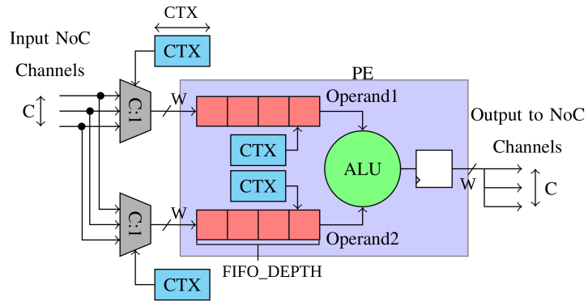
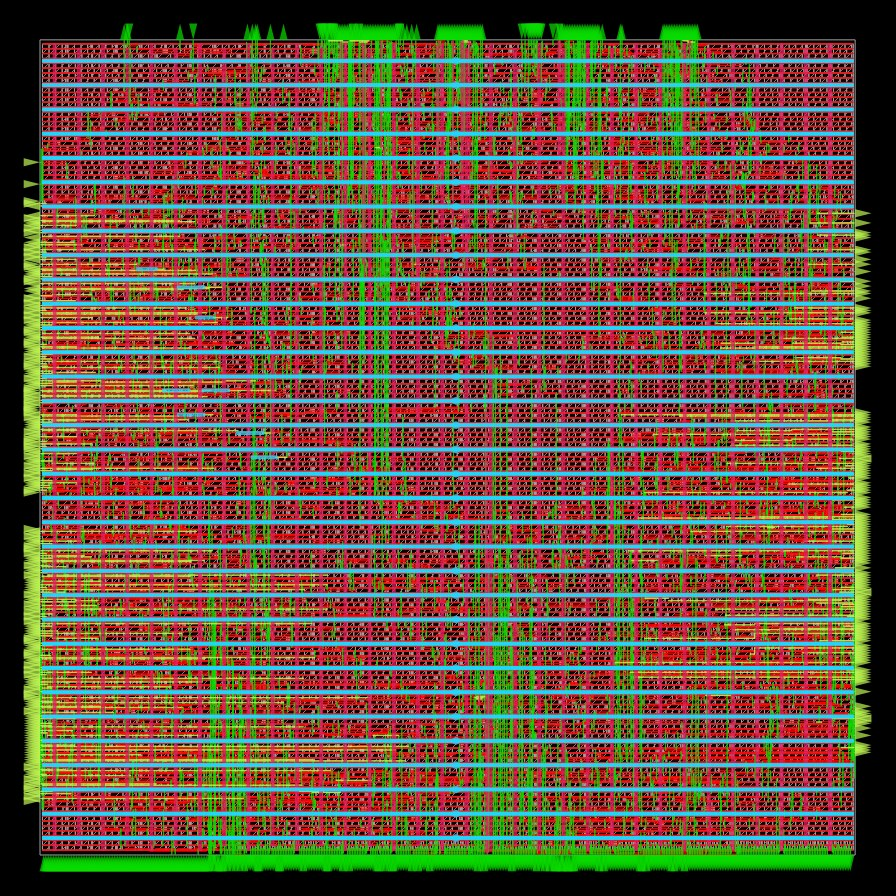
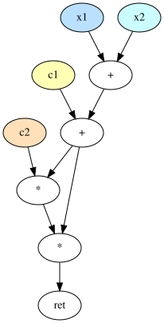
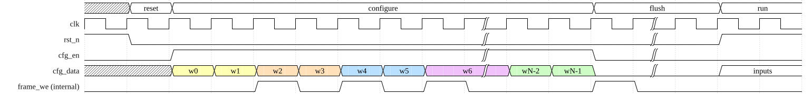

# Tea for two-by-two: Taping out tiny tiles


Welcome back! This is the second post in a series on a coarse-grained reconfigurable architecture (CGRA) I designed as part of a research project as an undergrad. This is a follow-up from my [last post](blog-mocarabe-fpga.html) which explains the architecture, the compiler, and my current project goals. Onto square two!

When I revived this project a few months ago, here were my goals
1. Dust off the cobwebs so that I can be proud of the project again
2. Turn it into a platform for experimenting with computer architecture and semiconductor engineering
3. Make a real Mocarabe chip with the Tiny Tapeout program

This post highlights my efforts towards item 3.   
I was working on a small team [taping out an FPGA product](https://www.zeroasic.com/blog/platypus-z1015-launch), and I knew that when it was over I wanted to turn the crank on a chip again, but this time on something I could fully own myself. Luckily, open-source EDA tools and the Tiny Tapeout program exist now, and I can get my own chip made for a few hundred bucks!


## I'm a little tapeout

I gathered I needed the following before I could submit to Tiny Tapeout:
- To get a generated Mocarabe architecture through an ASIC synthesis flow
- To identify a realistic architecture given significant area and pin-count constraints
- To enhance the architecture with a pin-efficient programmable bitstream mode, an upgrade from its current static bitstream mode
- To verify the chip enough to justify the 600 American dubloons I had to pony up
- And finally, to ensure that I can map a few real of my benchmark kernels (shown below) to the resulting architecture 


```c slides adder_chain fig3 level1_linear poly3 poly_quadratic

void adder_chain(uint8_t x, uint8_t y, uint8_t z, uint8_t a, uint8_t* ret)
{
    *ret = x + y + z + a;
}

void fig3(uint8_t a, uint8_t b, uint8_t c, uint8_t* y)
{
    *y = a*b + c + b;
}

void level1_linear(uint8_t x1, uint8_t x2, uint8_t c1, uint8_t c2, uint8_t* ret)
{
    uint8_t T1 = x1 + x2 + c1;
    *ret = c2*T1*T1;
}

void poly3(uint8_t x, uint8_t c, uint8_t* y)
{
    *y = x*(1 + x*(5 + x*c));
}

void poly_quadratic(uint8_t x, uint8_t c, uint8_t* y)
{
    *y = 1 + x*(5 + x*c);
}
```


Before we start, I need to actually choose a process node. The upcoming tapeouts when I was ready to start the project had Skywater 130 and GF180 on display. A man with less self-control than me might say "Skywater?  You mean... rain?" and "GF180? Sounds like my dating life", but I won't stoop so low. It seems like SKY130 is a better choice, since it's the original Tiny Tapeout target. Also, smaller is always better and 130nm < 180nm. Plus, I worked with a GF process in the past, so I need to maximize my résumé keyword surface area.

Tiny Tapeout charges per "tile", and a tile is about 167 × 108 µm, or around 18,000 µm². The recommended density is around 60%. Finally, every Tiny Tapeout project on SKY130, no matter how many tiles it buys, has a hard constraint of 26 pins: 8 inputs, 8 outputs, 8 bidirectional pins, `clk` and `rst_n`.
I'm pretty lucky because I have a highly parametrizable architecture; it's a two-dimensional array with highly configurable parameters. It's statically scheduled, so I can deterministically know if a kernel will map to a given configuration. I have the following knobs to play with, so long as I can identify ~5 benchmark kernels that can map onto the resulting architecture:

| Knob | Parameter | Notes |
|------|-----------|-------|
| Spatial grid and operator composition | MxN | The smallest realistic size is 2x2 processing elements (one mult, one input, one output, and one adder) |
| Maximum context depth | CTX | The maximum temporal dimension of the grid, i.e. how many time slots each PE cycles through |
| Initiation Interval | II | The temporal dimension of a specific kernel mapped onto a grid, this is bounded by CTX  |
| Data bitwidth | W | No need to preserve the 32-bit default |
| Interconnect channel count | C | The minimum that will let the benchmark kernels route |
| PE SRL depth | FIFO_DEPTH | How long an operand can wait in a PE's operand FIFO |



## Short and stout
### Synthesizing a small layout

First, I have to actually get the kernel running through an ASIC synthesis tool. The first step is linting the kernel.

I ran it through [slang](https://github.com/MikePopoloski/slang)'s linter and through the yosys-slang (now sv-elab) synthesis plugin. The linter told me I had to fix my `timescale` directives to be consistent throughout every file (easy!).
Synthesis told me to fix this (it expressed itself by segfaulting):
```verilog
initial begin
    assign data = INIT;
    while (CLK === 1'b1 || CLK === 1'bX) #10;
    deassign data;
end
```

which is a simulation-only trick: it pins `data` to `INIT` until the clock first goes low, then lets go. I swapped it for a plain `reg [63:0] data = INIT;`, which every tool I threw it at was happy with. This module was, for some reason, based on a simulation model of a Xilinx shift register primitive I stumbled on when I first wrote the RTL. Don't ask me why I didn't just write my own (I don't remember!).

So it synthesizes now. Let's run it through a sky130 flow! For this, I'll use [SiliconCompiler](https://github.com/siliconcompiler/siliconcompiler)'s stock `skywater130_demo` target on the same plain-jane test kernel my lint test uses: the `adder_chain` benchmark at II = 1 with 20 channels and the default 32-bit datapath:



That's not bad! It routed fine, but it will definitely take a few tiles. I haven't even added the programmable bitstream network yet, which will add some area.

Jumping ahead to the final chip's configuration (more on how I picked it below), let's look at the worst case: where does the area go in the multiplier PE?

. Flip-flops are 72% of it; the multiplier is only about 4%.")

In this configuration (a 2x2 array with CTX = 6, W = 8, C = 2 and 16-deep operand FIFOs), the actual multiplier is a tiny amount of area. The overhead of the massive FIFOs that allow for such staggered data arrival times (e.g. if the dataflow graph is unbalanced), the interconnect switches, and the configuration storage dominate. This is a high-overhead architecture. But I'm not changing it, because this is for fun!

To pin down an architecture, I had to add a fixed device JSON format, so that every benchmark compiles onto the *same* array. Until now the compiler sized the grid to each dataflow graph, which is fine for an FPGA overlay you can re-synthesize, but a chip only gets made once. A device file is an ASCII grid of PE types plus a channel count. The placer is only allowed to permute nodes onto matching PE types, and the compiler rejects a benchmark up front if it can't fit at the requested II.

Here's my proposed fixed architecture:

```json
{
  "name": "tt_2x2_1mul",
  "grid": [
    "+   * ",
    "IO  IO"
  ],
  "channels": 2,
  "ii_max": 6
}
```

## Here is my handle, here is my pinout
### Here's the pinout
Now you may want me to get to the programmable bitstream. Unfortunately, that's not how the nursery rhyme goes, so I'm going to talk about pinout first.

As mentioned earlier, I have access to 26 pins (`clk`, `rst_n`, 8 `input`s, 8 `output`s, 8 `inout`s, no In-N-Outs). I'll have to share this between the bitstream-programming mode (which we will talk about soon, I promise!) and the regular run mode.

For the run mode, I have access to at most one byte of input and one byte of output per cycle. You might think I could steal 4 bits from the inouts for each and make this a 12-bit architecture, but I'm not insane and I need to add an `output_valid` output pin in the inout range since the first few dozen cycles (until all inputs have been processed) can have invalid outputs. Since I've gone with a context depth (CTX) of 6 (more on why 6 in the verification section), this is the upper bound on the kernels I can map: they can have at the very most 6 inputs and 6 outputs.

Here's the pinout for the regular execution mode:

| Pin          | Run mode     |
|--------------|--------------|
| ui_in[7:0]   | input byte   |
| uo_out[7:0]  | output byte  |
| uio[1]       | output valid |
| rst_n        | high         |
| clk          |toggling4ever |

Here's what run mode looks like for level1_linear (DFG shown below), the demo kernel the chip ships with: its dataflow graph, then its inputs and output on the pins.



 and ret appears on uo_out at cycle 55, all repeating every 4 cycles.")

## When I get all streamed up
### Adding programmable bitstream

The biggest architectural feature missing from Mocarabe is a programmable (soft) bitstream mode. When we were working on the FPGA backend, we compared the toolchain directly to Vivado HLS. Thus, the understanding was that 
we would be able to run the toolchain much faster than Vivado on a pre-existing bitstream and simply update the `readmem`s. The idea was that no matter what, we'd probably be able to find a way to
patch new Mocarabe toolchain results (CGRA configurations) onto the overlay bitstream. Now, I know that that isn't possible; we could have done this if the memories were stored in BRAM (and we could read every value we wrote every cycle), but all our `readmem`s actually got blasted into LUTs (as intended).
All that to say, we have to design a programmable bitstream protocol for our real CGRA. We will tape out one chip and we will map as many kernels as we want onto this chip. We have 24 I/O pins on our Tiny Tapeout architecture (plus `clk` and `rst_n`), which isn't much. We want a protocol that can also work well on architectures with more pins. Thus, word width should be configurable, and we should not include an address with every bitstream word.

So here's the idea.
We necessarily have clk and rst_n as top-level ports. Then we need cfg_en and cfg_data[CONFIG_WIDTH-1:0]. These can overlap with the run-mode pins, though!

A *word* is one CONFIG_WIDTH-bit chunk of the bitstream: whatever cfg_data carries in one clock. Given that we've already committed to 8-bit data widths, making CONFIG_WIDTH 8 makes sense, so a word is a byte.

To configure, hold rst_n low the whole time:
1. Hold cfg_en low for at least one clock. This resets the loader's word counter and points it back at the first config row.
2. Raise cfg_en and send one CONFIG_WIDTH-bit word per clock. Every frame's worth of words (three on this chip) gets written into the next config row. If cfg_en drops partway through, programming starts over from the first row, and any words after the last row are ignored, so the counter never "rolls over".
3. After the last word, drop cfg_en and keep rst_n low for a few more clocks (48 on this chip) to flush the FIFOs, then release rst_n. The first rising edge with rst_n high is run cycle 0.



For our chosen target architecture, how much does area increase with a soft programmable bitstream mode? I synthesized the final chip both ways with the same yosys script (sky130, before place and route), using level1_linear as the kernel for the hard-wired version. The programmable chip comes out about 4× bigger: roughly 42K µm² against 10K µm². The hard-wired version is cheap because synthesis can delete every FIFO tap, channel and mux input that the one baked-in schedule never uses. The programmable version has to keep all of them, plus the config rows that hold the schedule. That's the price of a chip that can run more than one kernel.

Following up from the last section, here's the final pinout with the configuration mode added:

| Pin          | Config mode | Run mode     |
|--------------|-------------|--------------|
| ui_in[7:0]   | cfg_data    | input byte   |
| uio[0] (in)  | cfg_en      | low          |
| uo_out[7:0]  | —           | output byte  |
| uio[1] (out) | —           | output valid |
| rst_n        | held low    | high         |


## Hear me shout
### *Verification*
Remember those five kernels from the start of the post? Let's see if they can map to our Chosen Architecture.
We have one adder, one multiplier and two IO PEs, a kernel needs an II of at least its number of additions, at least its number of multiplications, and (since we only have one input bus), at least its number of inputs.

For each of the five benchmark kernels, the toolchain generates a testbench that programs the array through the soft bitstream, one byte per clock, the same way the real chip gets programmed. It then runs the kernel and checks every PE's output and operands on every cycle against values computed from the dataflow graph. I simulated each one in iverilog with the following settings: 8-bit data, 16-deep FIFOs, CTX = 4 and 8-bit config words.

The kernels are big enough that the minimum II we can start with is 4. However, that fails because the FIFOs are not deep enough to hold onto to matching operands! The arrival orders are so skewed that we get an arrival order error when generating the bitstream.

How do we get out of this? First, we can increase CTX (the upper bound on II). This makes the programmable logic use more area, but it doesn't scale too badly. I can use a fanout-splitting option to give a copy of the operand a better chance of having an arrival window shared with its match. The second option is to the FIFOs deeper. Unfortunately, these are expensive (as seen in the chart above), because they grow for every PE, and in pairs within every PE, and they scale with bitwidths too. This is too bad, but it's an architectural choice that we have to pay. They were cheap on FPGAs, I promise!

Let's sweep both of these across our favorite kernels, and run synthesis to get cell counts:


So, obviously, based on this data, I re-generated the chip with CTX 6 and a FIFO depth of 16. Upgrading the FIFO depth would be a direct fix of the skewed arrival time problem, but it's extremely area-expensive. Adding an extra context is much cheaper, especially if paired with the fanout-splitting option on an input (which we need to apply for some of these kernels to map).

On the regenerated chip, all five kernels map and pass in simulation: adder_chain, level1_linear and fig3 (with split fanout) at II = 4, poly_quadratic at II = 5 and poly3 at II = 6.

So, great! We built verification infrastructure (compiler-generated testbenches) to ensure our kernels can map to our generated architecture, and we were able to modify our architecture based on real applications we want to make use of! 

## Chip me over
### *Tiny Tapeout*


I submitted by Tiny Tapeout project by forking a GitHub repo from their template and pushing my design. That runs a GitHub action and once that is DRC-clean, we're good to go!
Synthesis put the design at about 63,000 µm², 57% of the 3x2 block's core and just under the 60% placement density the flow targets. Place and route then added about 20,000 µm² of repair buffers, 3,000 µm² of clock tree and 2,000 µm² of tap cells, so the final block has 8,314 standard cells taking up 88,286 µm², or 80% of my real estate. It routed with no DRC errors and 5.6 ns of setup slack at 50 MHz. I'm not surprised, since the architecture is so generous with its pipelining. 

With everything green, I submitted Mocarabe to the TTSKY26d shuttle. Now I wait for the chips to come back!

### And pour me out!

Thanks for reading this far (or skipping to the end?). This was fun. 
In the next post in this series, I'll dig into the GDS itself.

Goobdye!


#### Credits
- Prof. Nachiket Kapre (University of Waterloo), who conceived and supervised the original project
- Alireza Mellat, co-author of the FCCM paper, who wrote his Master's thesis on an expanded version of the original project

#### Links
- [FCCM 2021 paper](https://ieeexplore.ieee.org/document/9444076)
- [Alireza Mellat's Master's thesis](https://uwspace.uwaterloo.ca/handle/10012/17993)
- [Mocarabe GitHub](https://github.com/gigeresk/mocarabe)
- [Tiny Tapeout](https://tinytapeout.com)
- [SkyWater SKY130 PDK](https://github.com/google/skywater-pdk)
