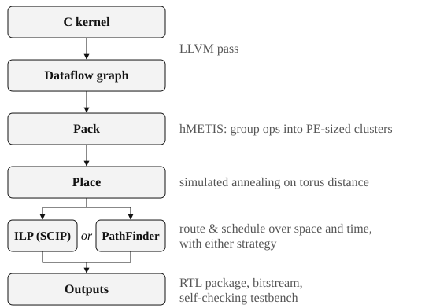
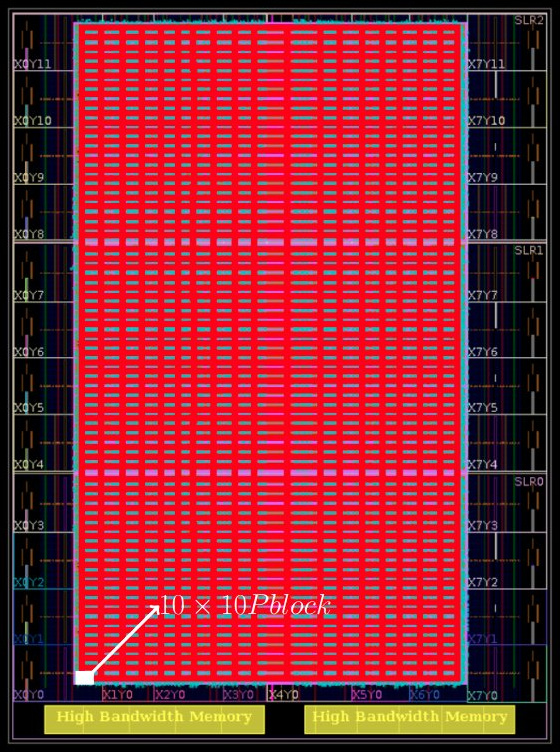

# Back to square one: Routing in space and time on a toroidal CGRA
Coming back to something you wrote years ago is like moving back into your childhood home. Everything is where you left it, it's smaller than you remember, and the wiring isn't up to code.

As an undergrad, I really wanted to work on a research project, and the professor for my favourite class (ECE 357: Digital Hardware Systems) took me under his wing. He proposed Mocarabe: a CGRA overlay, which is a grid of small, time-shared processors built on top of an FPGA, along with a compiler built around a router formulated as an integer linear program. As the scope expanded, I kept enthusiastically saying yes until we had a full toolchain with multiple compiler strategies and a complete hardware implementation running on Xilinx FPGAs.

I was paired up with a Master's student, and together we wrote a paper (*Mocarabe: High-Performance Time-Multiplexed Overlays for FPGAs*) that was published at FCCM. That work has since helped me land at least three jobs. The last of these involved building an FPGA architecture generator that mirrored what I'd done on Mocarabe, which reignited my interest in the old project.

I had three goals for this revival:
1. Dust off the cobwebs so that I can be proud of the project again
2. Turn it into a platform for experimenting with computer architecture and semiconductor engineering
3. Make a real Mocarabe chip with the TinyTapeout program

This is part 1 of a series about reviving Mocarabe. This post covers the architecture, the compiler, and what I've changed over the past few months to meet the first goal and start on the second.

## House tour: The architecture
Before the tour, some vocabulary. A CGRA is a coarse-grained reconfigurable architecture: a chip that can be reprogrammed at a coarser level than
more traditional reconfigurable architectures such as field-programmable gate arrays (FPGAs). An FPGA is configured bit by bit, with lookup tables and single wires, while a CGRA is configured whole operations at a time, with adders, multipliers and word-wide buses. CGRAs are typically composed of processing elements (PEs) that specialize
in one task (such as arithmetic or accessing memory) connected with a programmable interconnect.

A CGRA overlay is an implementation of a CGRA on top of an FPGA. FPGA place and route can take hours, and designs written in high-level synthesis often run at low clock speeds. An overlay is placed, routed and floorplanned once, so it runs fast (645–768 MHz in the paper), and mapping a new design means compiling for the overlay instead of rerunning the FPGA tools. The alternative is to build the CGRA as its own chip (an ASIC), which is where this series is headed.

Mocarabe is an array of PEs that can perform addition, multiplication, or off-chip access to data (inputs and outputs). The PEs are connected with a two-dimensional torus network, with only northbound and eastbound links. A switch next to every PE steers data through the interconnect, and each link carries *C* channels, set when the architecture is generated. The diagram below illustrates this design:

.")

Each PE and switch cycles through a fixed number of configurations (one per clock cycle), then repeats. Each of these is called a *context*, and how many there are is the *context depth*. A deeper context lets more operations share a resource, at the cost of throughput. Thanks to this resource sharing, a design with more operations than PEs can still fit onto an architecture.

Once data reaches a PE, it must wait until its matching operand also reaches the PE and until the PE itself is ready to perform the computation. Each operand waits in a 64-deep operand FIFO (really a shift register that can be read at any position) until the computation needs it. To reach high clock speeds, the PEs and switches are deeply pipelined, so every operation and every hop takes several cycles.

, one entry per context (the figure's II is the context depth), reconfigure each part every cycle. Fig. 2 from the [FCCM paper](https://ieeexplore.ieee.org/document/9444076).")

Every bit of data movement is statically scheduled: the compiler decides ahead of time which channel every value uses in every context, with no runtime arbitration. That's why routing here is really a scheduling problem, which brings us to the compiler.

## Full house: The CAD flow

The flow implemented in the paper was built to compare against Xilinx's Vivado HLS tool. 
A user provides a dataflow kernel they want to map to a CGRA architecture, and an RTL package that can target a Xilinx device in Vivado comes out. 
The paper's flow sized a new architecture for each kernel; the flow below is the newer one, which maps onto a fixed architecture instead.

For example, this kernel, which is the one in the figures below:

```
int poly(int a, int x, int* y) {
  *y = (2*a + x) * x * x;
}
```

First, an LLVM pass extracts the dataflow graph (DFG) from a C kernel.



Then, the graph is coarsened (or packed) into a clustered netlist. The size of the clusters is bounded by the context depth, and the number of clusters
is bounded by the number of PEs in the array. This is done with a hypergraph partitioning algorithm, hMETIS, though I also had it implemented in integer linear programming at some point.

 × x². Right: the same graph partitioned into IO, adder and multiplier PEs. Figs. 4 and 5 from the [FCCM paper](https://ieeexplore.ieee.org/document/9444076).")

Next, the clusters are placed using simulated annealing with a wirelength minimization target. Simulated annealing makes random moves (here, swapping PEs), and early on it sometimes accepts moves that make things worse, so it doesn't get stuck in a local optimum; as it cools, it gets pickier. Below, we see the placement for a fixed 11 × 14 architecture. PEs are displayed in their physical arrangement (which is why this doesn't look like a torus at first glance; the difference between logical and physical arrays is explained at the end of this post).


After that comes the routing. This is the core of the project, and the first to come to fruition! We specify an integer linear programming formulation to determine what nets must leave a source PE, which ones must enter a sink PE, a bunch of constraints describing the interconnect movement, and an objective that minimizes the total number of hops: every link a value crosses, in every context, counts as one. As you can guess, I had to produce a number of visualization tools to wrap my head around this and develop the constraints properly. The [paper](https://ieeexplore.ieee.org/document/9444076) goes into a lot of detail about the specific constraints I used.

I actually went through the trouble of writing an entirely alternate router, which was based on a temporal-spatial PathFinder paper (congestion is negotiated between
routes). It was fun but a lot more maintenance than the ILP formulation and the results weren't as good. Creating the routing graph was very satisfying, because it had a time 
dimension.

 and runtime (bottom) for the ILP and PathFinder routers at a context depth (II) of 1 and 2. These are the paper's results, using the Gurobi version of the ILP. Fig. 12 from the [FCCM paper](https://ieeexplore.ieee.org/document/9444076).")

Both routers illustrate a really nice feature of the architecture, which is that it's toroidal both in space and time. Interconnect loops over the edge back to square one both
horizontally and vertically, and every shared resource goes back to its owner in the first cycle once the context wraps back around to 0.


.")

The CAD flow emits an RTL package with the correctly-parametrized architecture, the bitstream from the mapped design, and a self-checking testbench.

I really liked doing this flow because I mostly had no idea what I was doing. The joy of solving EDA problems with so little experience or context was 
freeing and very satisfying.

It may be worth taking a more in-depth look at the algorithms in play for a future post, especially the dual PathFinder/ILP router implementations.

## Home improvement
What did I have to do to get the project up to snuff? Nobody had touched the code since May 2021. My comic books were still under my bed but my Game Boy battery was fried.

Here's what changed over the course of a few months:
- Modernized the Python (pyproject.toml, type annotations, auto code formatting, the list goes on)
- Added a test suite that runs arch generation, design mapping, and simulation end-to-end. These tests are what found the bugs.
- Separated architecture generation from CAD, which let me write a flow that maps multiple designs to a fixed device spec, more akin to how physical CGRAs and FPGAs work.
- Replaced the gcc plugin we had with an LLVM pass, mainly because I couldn't remember why we didn't originally write an LLVM pass
- Swapped the expensive Gurobi optimization solver for the free SCIP package (via PySCIPOpt) because I'm no longer eligible for the educational license (kind of like aging out of your parent's insurance!).
  The transfer was quite easy, and my formulations are small enough that SCIP's slower solves don't matter.
- Made the simulated annealing placer deterministic. I originally thought randomness was great for solution space exploration, but years working on FPGA placement algorithms taught me otherwise. A bug you can't reproduce is a bug you can't fix.


## Structural fumigation

Adding test coverage turned up a number of bugs. I'll just cover a few, and I'll apologize in advance for the names I gave them:
 - **SCIP town:** Replacing Gurobi with SCIP exposed a bug in the schedule writer (which turns the ILP solution into a bitstream). The writer compared == 1.0, so SCIP's 0.9999999999999998 silently dropped some links. The fix was, of course, to round the solution before comparing. I thought it was called integer linear programming... Turns out solvers only promise integers to within a tolerance, and Gurobi had been politely handing me exact ones for years.
 - **Loop-de-loop:** this was a tricky bug in my ILP formulation, which was only exposed as I ran on larger designs. The solver could satisfy the constraints with closed loops of links that never connected to the source, so the data never arrived. Now every link along a route carries an ordering label that has to increase from the source, so a route can't loop back on itself.
 - **Fee FIFO Fum:** Operands could wait longer than the 64-deep FIFO could hold, so its read position wrapped around and the PE read the wrong operand. The scheduler now caps how long an operand can wait, and there's a new fanout-splitting option for designs that have trouble mapping due to unbalanced arrival times.

I may go into depth on the last one in a future post, because it highlights a vulnerability of the architecture. It's deeply pipelined, so small differences in when operands arrive can overflow the operand FIFOs. This is mitigated for now, though, and won't lead to correctness issues anymore.

All that got me to... more or less where I thought I was when I submitted the paper. The paper's clock frequencies come from the hardware, so they stand. The channel counts came from the compiler, and fixing these bugs could only push them up, not down. I haven't rerun the paper's benchmarks to see whether any did.

## Bringing down the house
That brings you up to speed on what the project does and what I've been up to. Before we go, here are some parting points (I have trouble saying goodbye).

A note on the original implementation: the original paper targeted the Xilinx Alveo U280.
Targeting a real FPGA and comparing against Vivado's high-level synthesis was the crux of the paper, and the details are in there.
Here's a device view:



One interesting physical question is, on a real system, wouldn't the torus's wrap-around
over the edge lead to a necessarily long path from one edge of the chip to the other? Yes, if you placed blocks in their logical positions.
But there's a trick to folding toroidally-connected blocks so that every link, wrap-arounds included, spans at most two blocks, as seen below (wrap-around links in red,
and logical coordinates preserved):

 and folded (right). Wrap-around links are in red.")

There are three things standing between this project and a tapeout:
- Adding a programmable bitstream interface
- Adding better verification coverage and more test designs
- Running OpenROAD tools on an appropriately-sized architecture

Thankfully, I've done all of these things before (on other projects) and I just need to run them on Mocarabe! And you'll hear all about it in the next episode. 

Goobdye! (I told you I have trouble saying it).

Roll credits! 

### Credits
- Prof. Nachiket Kapre (University of Waterloo), who conceived and supervised the original project
- Alireza Mellat, co-author of the FCCM paper, who wrote his Master's thesis on the original project and extended it to mesh and butterfly fat-tree networks

### Links
- [FCCM 2021 paper](https://ieeexplore.ieee.org/document/9444076)
- [Alireza Mellat's Master's thesis](https://uwspace.uwaterloo.ca/handle/10012/17993)
- [Mocarabe GitHub](https://github.com/gigeresk/mocarabe)
- [TinyTapeout](https://tinytapeout.com)
